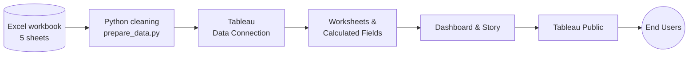

# 🏎️ Formula 1 Race Intelligence Dashboard

An interactive **Tableau** project analysing **6,464 race entries across 334 races and 17 seasons (2010–2026)**: championship points, tyre strategy, circuits and host countries, podium achievements, and driver and team reliability (DNFs).

> Built for the **Skill Wallet (SmartBridge)** project programme.
> **Skills:** Tableau · Dashboard Design · Data Visualization · Data Preprocessing

## 🔗 Live Links
| | Link |
|---|---|
| 📊 Tableau Public dashboard | `<paste-tableau-public-url>` |
| 🎥 Demo video | `<paste-demo-video-url>` |
| 🌐 Embedded web page | `<paste-page-url-or-remove>` |

## 📌 Contents
[Overview](#-overview) · [Scenarios](#-scenarios) · [Architecture](#-architecture) · [Key Insights](#-key-insights) · [Repository](#-repository-structure) · [Getting Started](#-getting-started) · [Data](#-data) · [Phases](#-project-phases) · [Requirements](#-system-requirements) · [Author](#-author)

## 📖 Overview
Turns raw F1 race results into a decision-support dashboard for team strategists, broadcasters and regulation analysts. Users can:
- Track **championship points trajectories** across seasons
- Compare **tyre compound strategies** and their effect on results
- See **circuit and host-country** participation
- Analyse **DNF causes** and reliability by team and driver
- Explore **podium and win** distributions by driver, team and nationality

## 🎭 Scenarios
| # | Persona | Goal |
|---|---------|------|
| 1 | **F1 Team Performance Strategist** | Benchmark points trajectory against top teams, evaluate tyre strategies, find strong talent pools |
| 2 | **Motorsport Broadcast Analyst** | Pull leaderboards, host countries and podium infographics for broadcast content |
| 3 | **F1 Technical Regulation Analyst** | Study DNF patterns and reliability across 17 seasons to judge regulatory impact |

## 🏗️ Architecture


## 🔍 Key Insights
> The dataset appears **simulated** (for example, current-era drivers appear in every season), so these findings describe *this dataset*, not real F1 history.

- **Top team by points:** Red Bull Racing (8,006), then Mercedes (7,790) and Ferrari (5,778)
- **Season-leading team:** Red Bull 8 seasons, Mercedes 7, McLaren 2
- **Most wins:** Lewis Hamilton 118, Max Verstappen 100, Charles Leclerc 44
- **Tyres:** Soft starts score the most points (5.12 average) but have the highest DNF rate (7.3%); the best strategy is Hard→Hard→Medium (6.41 points average)
- **Reliability:** Mercedes is most reliable (4.3% DNF), Haas least (8.4%)
- **DNF causes:** Engine leads (73 of 396 DNFs), but all six causes are close
- **Trend:** DNF rate was 5.9% in 2010–2018 and 6.3% in 2019–2026, so no improvement in this dataset

Full breakdown: [`docs/INSIGHTS.md`](docs/INSIGHTS.md)

## 📁 Repository Structure
```
f1-race-intelligence-dashboard/
├── README.md
├── LICENSE
├── requirements.txt
├── data/
│   ├── raw/F1_Racing_Project_Dataset.xlsx
│   └── processed/            # Tableau-ready CSVs
├── scripts/prepare_data.py
├── tableau/                  # .twbx workbook + calculated_fields.md
└── docs/                     # report, insights, Tableau steps, screenshots
```

## 🚀 Getting Started
```bash
git clone https://github.com/<your-username>/f1-race-intelligence-dashboard.git
cd f1-race-intelligence-dashboard
pip install -r requirements.txt openpyxl

# Rebuild the Tableau-ready CSVs from the workbook
python scripts/prepare_data.py
```
Then in Tableau: **Connect → Text file → `data/processed/f1_clean.csv`**, or open the packaged workbook in `tableau/`. Sheet-by-sheet instructions: [`docs/TABLEAU_STEPS.md`](docs/TABLEAU_STEPS.md).

## 🗂️ Data
| Sheet | Rows | Use |
|-------|------|-----|
| `race_results` | 6,464 | Main fact table (19 drivers, 10 teams, 24 circuits) |
| `championship_standings` | 311 | Season standings, wins, podiums, champion flag |
| `lap_intelligence` | 3,814 | Lap and sector times, tyre age, DRS |
| `qualifying_results` | 3,130 | Qualifying times |
| `circuits` | 29 | Circuit type, altitude, direction |

**Derived fields:** `is_win`, `is_podium`, `nationality`, `driver_label`, `first_compound`, `num_stints`.

**Known data issues**
- Carlos Sainz appears twice in every race (Ferrari and Williams); use `driver_label` to separate them
- Bahrain hosts 115 of 334 races, which skews host-country charts
- 2,817 of 3,130 qualifying rows use placeholder names (`Driver_N`, `Team_N`)
- 2026 is a partial season (12 races)
- `nationality` is an added lookup, not in the source workbook

## 🧭 Project Phases
- [ ] Data collection and extraction
- [ ] Data preparation
- [ ] Data visualization
- [ ] Dashboard
- [ ] Story
- [ ] Performance testing
- [ ] Web integration
- [ ] Demonstration and documentation

## 💻 System Requirements
- **CPU:** dual-core (i3 or equivalent); recommended i5 / Ryzen 5+
- **RAM:** 8 GB minimum; 16 GB recommended
- **Storage:** 2–3 GB free; SSD with 10+ GB recommended
- **OS:** Windows 10/11 (64-bit) or macOS
- **Software:** Tableau Desktop or Tableau Public
- **Browser:** latest Chrome, Edge or Safari

## 🖼️ Screenshots
Add your final dashboard screenshots to `docs/screenshots/` and link them here:
```markdown

```

## 👤 Author
**Ali**, CSE student, aspiring AI/ML Engineer
- GitHub: `https://github.com/<your-username>`

## 📄 License
MIT, see [LICENSE](LICENSE).
